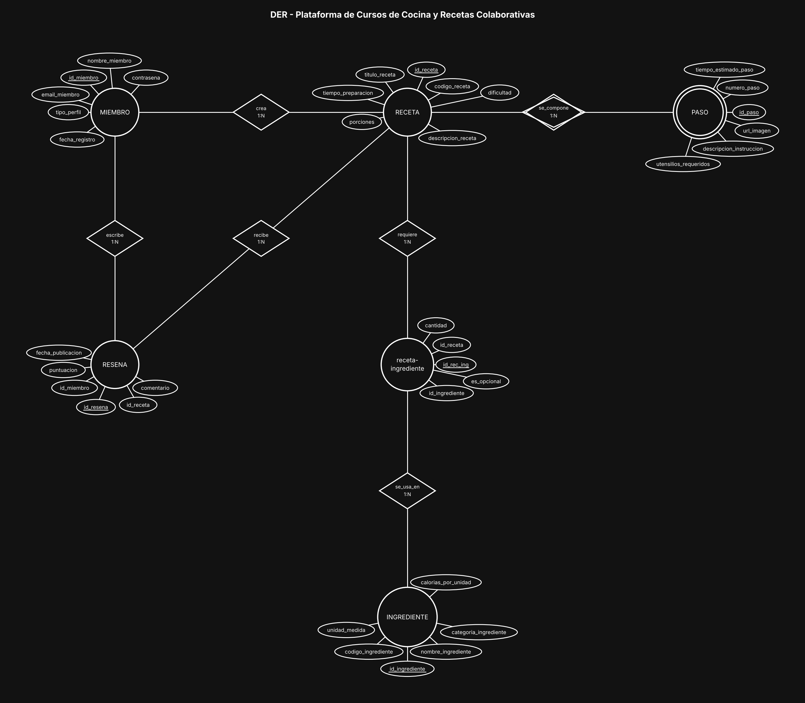

# BaseDeDatos-U2-Ej14-RecetasColaborativas

Base de Datos - Unidad 2 - Ejercicio 14

## Consigna

Modelar una comunidad online de gastronomía: miembros aficionados y profesionales que publican recetas, recetas con su lista de ingredientes y cantidades, pasos de preparación ordenados, y reseñas con puntuación de otros miembros.

## Lógica

**MIEMBRO 1:N RECETA.** El enunciado es explícito: una receta es creada por un único autor. No hace falta N:M. Si más adelante se quisieran recetas colaborativas entre varios chefs, se agregaría una intermedia `miembro-receta` con el rol de cada uno.

**Receta ↔ Ingrediente: N:M con `receta-ingrediente`.** La `cantidad` es el caso de manual de atributo del vínculo: 200 gramos no es una propiedad de la harina ni de la receta, es la propiedad de *esta harina en esta receta*. La `unidad_medida` en cambio sí es del ingrediente, porque es su unidad estándar y no cambia entre recetas. Se agregó `es_opcional` para distinguir los ingredientes prescindibles sin duplicar la receta.

**PASO como entidad débil de RECETA (composición secuencial).** El "Paso 1" no significa nada fuera de su receta: el número se repite en todas. Su PK es `id_paso` y la identidad lógica es `id_receta` + `numero_paso` (UNIQUE compuesto); la relación es identificatoria, por eso el círculo y el rombo doble. El orden de la secuencia no es un campo suelto sino parte de la identidad, que es justo lo que pide el punto 3: la numeración garantiza la secuencia y no puede haber dos pasos 3 en la misma receta.

**RESENA: N:M entre MIEMBRO y RECETA.** `puntuacion`, `comentario` y `fecha_publicacion` son atributos del acto de evaluar, no del miembro ni de la receta. Fijate que MIEMBRO se relaciona **dos veces** con RECETA por caminos distintos y no redundantes: como autor (`crea`) y como evaluador (`escribe` una reseña). Son dos vínculos con significados diferentes, por eso conviven sin pisarse.

**Restricciones de integridad a considerar:** `puntuacion` entre 1 y 5 (CHECK); UNIQUE sobre (`id_miembro`, `id_receta`) si el negocio quiere una sola reseña por persona y receta; idealmente un CHECK que impida que el autor reseñe su propia receta; UNIQUE sobre (`id_receta`, `id_ingrediente`) para que no se cargue el mismo ingrediente dos veces; `cantidad` mayor a cero; y borrado en cascada de pasos e ingredientes al eliminar la receta, ya que sin ella no tienen sentido.

**Nota sobre el alcance.** El contexto menciona clases virtuales en video, pero las reglas de negocio y el desarrollo requerido no las incluyen, así que no se modelaron. Si se pidieran, se agregaría una entidad CLASE dictada por un MIEMBRO con perfil Chef Profesional y una intermedia `miembro-clase` para las inscripciones.

**Convención de claves.** Toda entidad lleva como PK un identificador propio `id_<entidad>` (subrayado en el diagrama) y al menos 5 atributos además del id; el código o documento de negocio (`dni`, `codigo_*`, `legajo`, etc.) queda como atributo común con restricción UNIQUE. Las entidades intermedias de las relaciones N:M llevan los tres ids: el propio y las dos FK de las entidades que unen (UNIQUE compuesto sobre ambas FK). Atributos agregados para llegar al mínimo de 5 y que no figuran en la consigna: `utensilios_requeridos` en PASO.

## Resultado

